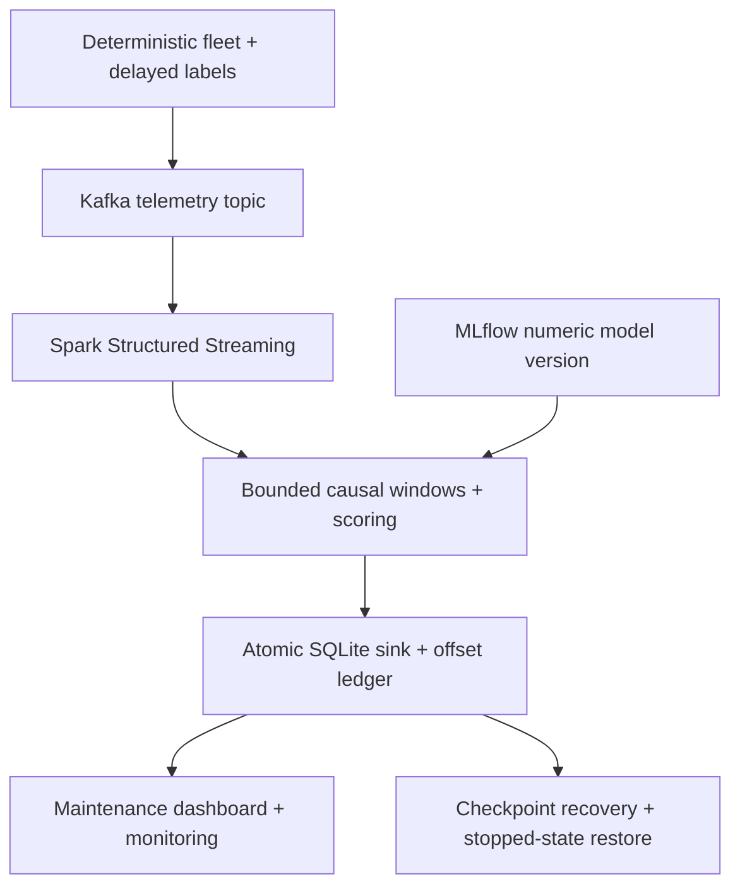

# Industrial Streaming MLOps

**Traceable maintenance warnings from sensor events, with an explicit false-alert budget.**

I built this reference to connect the parts that are often demonstrated separately:
stream ingestion, causal features, model evaluation, deployment identity and recovery.
A maintenance operator can inspect the machine, the sensor window, the model version
and the delayed outcome behind an alert.

The fleet and all its data are synthetic. The local path uses a real Kafka broker,
Spark Structured Streaming and an HTTP MLflow registry. Databricks has a separate
deployment and acceptance path; local Spark does not qualify the provider.

## What the operator gets

- A read-only dashboard showing pipeline freshness, accepted/rejected/duplicate
  messages, pending predictions, machine alerts and prediction-versus-label evidence.
- A fixed alert budget: **at most 2 false alerts per machine-day**, with at least
  **70% useful failure recall** and **5 minutes of actionable lead** on the held-out
  synthetic evaluation. Model-only p95 inference must be at most 1,000 ms.
- Explicit shadow mode when a model has not met its recorded gates.
- Numerical model activation and compatible rollback, separate from registry promotion.
- A raw ledger containing Kafka coordinates, original payload bytes and dispositions,
  so poison records, late arrivals and replays remain explainable.

These thresholds are checked in before evaluation. They are demonstration acceptance
criteria, not a maintenance service-level guarantee for real equipment.

## Qualification status

I keep the original receipts, source identities and failed attempts in the
[evidence index](docs/evidence/README.md). The [acceptance register](docs/acceptance.md)
separates the completed local checks from the remaining platform and release gates.

| Area | Current boundary |
|---|---|
| Application tests | **294 passed in 19.29 s**, zero failures/errors/skips; [current checks](docs/evidence/followup/README.md) |
| Native Kafka/Spark/MLflow and recovery | **21 checks passed** on the current reviewed source; [fresh service evidence](docs/evidence/followup/native/qualification.json) |
| Restored backlog and new input | **28 checks passed**: retained backlog, fresh input, immutable history and owned-process cleanup; [restoration evidence](docs/evidence/followup/README.md#restored-backlog-and-fresh-input-proof) |
| Model evaluation | Baseline and candidate met the recorded synthetic holdout gates; [original evaluation](docs/evidence/model/README.md) |
| Streaming comparison | Four measured variants; exact business-output parity across the three 24-hour variants; [benchmark evidence](docs/evidence/benchmark/README.md) |
| Hosted Docker reference | [CircleCI `reference-containers`](https://app.circleci.com/workflow/a1ff1428-da21-4550-afe2-8a7dc55d055c/job/424ad872-14fc-4952-ba99-970ee84cf7d7) **succeeded at `4bcc55e`**; original artifact bytes are not locally verified and four historical "SHA-256" strings have invalid lengths (65–66 hex digits). [Offline audit instructions](docs/evidence/circleci/README.md) |
| Real Chrome presentation | Chrome 157 desktop (1440px), narrow (600px), and HTTP-503 views **passed**; original screenshot bytes and JSON reports independently inspected. Narrow badge overlap corrected and geometry-regression checked. This is synthetic snapshot rendering, not live Kafka browser operation. [Proof](docs/evidence/browser-2026-11-16/README.md) |
| CircleCI Python unit CI | **Succeeded** at `579cbc5` ([#5](https://app.circleci.com/pipelines/circleci/Um5XQQtD4BE9Jcfy4XTzBb/TdzAEfEDkrojS9NSGQ12Uu/5?useNewPipelines=false)) and `ce7674c` ([#7](https://app.circleci.com/pipelines/circleci/Um5XQQtD4BE9Jcfy4XTzBb/TdzAEfEDkrojS9NSGQ12Uu/7?useNewPipelines=false)); merged [PR #4](https://github.com/mehdisafer/industrial-streaming-mlops/pull/4) |
| CI policy | **CircleCI is the acceptance CI** for Python, browser and separate Docker reference gates. Earlier GitHub Actions runs failed before runner assignment; more recent PR runs executed successfully. Provider-specific results stay source-bound. |
| Databricks | **Open**: implementation prepared; no authorized workspace run |
| Public source | **GitHub reports `public` and anonymous repository/README access was observed (16 November 2026)**. Project licence, release tag, published release and repository protections remain separate. |

See [scope issue #1](https://github.com/mehdisafer/industrial-streaming-mlops/issues/1),
[original delivery #2](https://github.com/mehdisafer/industrial-streaming-mlops/pull/2),
[follow-up review #3](https://github.com/mehdisafer/industrial-streaming-mlops/pull/3),
[CircleCI unit merge #4](https://github.com/mehdisafer/industrial-streaming-mlops/pull/4) and
[merged container qualification #5](https://github.com/mehdisafer/industrial-streaming-mlops/pull/5)
for the respective review and qualification states. The prepared release candidate is `v0.1.0-rc.1`; a tag and
GitHub release have not been published.

## Observed outcomes

### Local service chain and recovery

[The 15 November qualification](docs/evidence/followup/README.md) reconciled **4,380 raw records** into 2,164
accepted sensor events, 2,164 delayed labels, 24 heartbeats, 24 rejects and four
duplicates. It persisted **2,092 predictions and 12 alerts**, with no pending events
or predictions and observed lag of **zero offsets in each of three partitions**.
All 21 checks completed in 200.955 seconds, including service startup and recovery,
on source commit `daaa5b8`. The separately completed fixed-protocol training was
reused only after its training-source identity matched.

During an active Spark query, the broker stop-to-restart interval was 15.103 seconds;
the same active worker subsequently consumed 303 newly published recovery records.
The run also exercised failures before and after the sink commit, unavailable-model
recovery, candidate activation, rollback on new telemetry and stopped-state restore
of the database, Kafka logs, MLflow artifacts and checkpoint. The restored checkpoint
resumed with zero new input rows and no duplicate effects.

A separate **28-check restored-backlog exercise** completed in 95.825 seconds.
It restored **303 unconsumed messages**, processed **303 newly published messages**,
and ended with **4,077 raw records, 1,965 predictions and six preserved alerts**.
The same Spark query identity survived four worker runs; old labels, observations,
predictions and deployments were preserved. Source lag drained to zero and the
runner observed its owned processes stopped. Cross-host restoration remains open.

The dashboard returned real HTTP HTML and JSON from both sinks. A separate
13-assertion minimal-DOM/fetch check executed its actual JavaScript against the
restored snapshot: six alert rows, 40 prediction rows and recovery after an HTTP
error. The earlier local Chromium launch was blocked by the execution environment's
socket policy, as preserved in the
[historical follow-up](docs/evidence/followup/README.md#dashboard-and-unresolved-environment-gates).
A subsequent 16 November **real Chrome 157 run** successfully rendered the exact
dashboard HTML on a hosted Linux worker using **explicitly synthetic** API
responses. All three original PNGs and JSON receipts were independently
inspected and hashed: desktop, 600px responsive and unavailable-API states.
The first narrow rendering exposed a badge/subtitle overlap, which was
corrected and retested with a geometric assertion. See the
[original-browser evidence register](docs/evidence/browser-2026-11-16/README.md).
This does not certify live Kafka-backed rendering or accessibility.

### Held-out maintenance evaluation

The [original model evaluation](docs/evidence/model/README.md) used six machines and
72 simulated hours per train/validation/test split. The final holdout contains
**5,166 labeled feature rows, 24 failures and 17.9375 machine-days**. The following
metrics apply the 30-minute alert cooldown and the five-minute useful-lead rule:

| Model | False alerts | False alerts / machine-day | Useful failure recall | Alert precision | Median true-alert lead, s |
|---|---:|---:|---:|---:|---:|
| Baseline | 29 | 1.6167 | 87.5% | 42% | 919.36 |
| Candidate | 1 | 0.055749 | 100% | 96% | 962.61 |

Thresholds were selected on validation before final-test scoring. Both models met
the recorded gates. These are operational alert/failure metrics on the synthetic
feature-availability timeline, distinct from per-event classification recall and
wall-clock warning time. They establish behavior on this simulator; field-data
generalization, calibration and uncertainty estimates remain open.

### Bounded streaming measurements

[Benchmark03](docs/evidence/benchmark/README.md) completed in 84.614 seconds. All input
was published before each fresh worker started. The measured worker time includes
Python/JVM startup and shutdown.

| Simulated workload | Raw records | Kafka partitions / Spark local threads | Worker wall, s | Raw records / worker wall s |
|---|---:|---:|---:|---:|
| 2 hours | 205 | 1 / 1 | 13.294 | 15.42 |
| 24 hours | 2,317 | 1 / 1 | 16.182 | 143.18 |
| 24 hours | 2,317 | 3 / 1 | 18.956 | 122.23 |
| 24 hours | 2,317 | 3 / 2 | 18.645 | 124.27 |

Each 24-hour variant produced **1,141 predictions and four alerts**, with 18 additional
above-threshold predictions suppressed by cooldown. Features, scores, alert business
fields and cooldown outcomes matched exactly across those variants; all drained to
zero observed source lag. The 2-hour case produced 85 predictions and zero alerts.
These are single-host measurements from one run per configuration, with a driver/SQLite
sink. They provide no statistical speedup or distributed-scale claim. Original
latency, CPU/RSS and Spark progress measurements are retained with their boundaries
in the benchmark evidence.

## Architecture



Spark provides the real Kafka streaming source, envelope parsing, offset progress
and checkpoint lifecycle. The local `foreachBatch` sink runs reviewed validation,
watermark state, features and scoring in one bounded driver process. SQLite provides
one transaction over source dispositions and business outputs. This is a deliberate
small-deployment design, not a distributed feature engine.

The provider path uses Kafka and Delta on existing authorized Databricks compute.
It reuses the feature contract but has separate persistence, run identities and
qualification evidence. Its bounded replay adapter is not a Big Data scale claim.

Read the [architecture decisions](docs/architecture.md), [contracts](docs/data-contracts.md)
and [verified dependency baseline](docs/compatibility.md).

## Run the container reference

Requirements: Docker Engine with Compose v2, and a reference budget of four CPUs,
8 GiB RAM and 10 GiB free disk. These are requested local limits, not measured minimums.
The broker, registry and dashboard are published on loopback only. On the
qualified CircleCI Docker revision `4bcc55e`, Kafka, MLflow and dashboard also
join an ingress bridge so those loopback endpoints are reachable; the other
services remain on an internal network. This is not an air-gapped deployment:
ingress-attached services retain potential outbound connectivity.

CircleCI's `reference-containers` job succeeded on the exact Docker source
revision `4bcc55e`, after an earlier failed attempt on `ce7674c` (the old wrapper
pre-created `evidence/integration` and the smoke script correctly refused it).
The hosted result is linked above. The public CircleCI v2 API lists job #13
artifacts, but raw URLs require authorization and independent original-byte
verification remains open. Use the [bounded API downloader](scripts/download_circleci_artifacts.py)
and [offline evidence intake](docs/evidence/circleci/README.md) with a local
`CIRCLE_TOKEN` environment variable; never commit credentials or claim an
unverified SHA-256 baseline. Earlier detailed local service runs remain distinct. Its smoke script also requires
Bash, curl and Python 3 on the host.

```bash
git clone https://github.com/mehdisafer/industrial-streaming-mlops.git
cd industrial-streaming-mlops
docker compose build
docker compose up -d --wait kafka mlflow dashboard

docker compose run --rm cli generate \
  --output /state/input/events.jsonl --machines 6 --hours 24 --anomalies
docker compose run --rm cli train \
  --output /state/training --machines 6 --hours 72
```

Training prints and persists the actual registered numerical versions. On a fresh
registry, baseline and candidate are usually versions 1 and 2; inspect the returned
`model_version` values instead of assuming that on a reused volume.

```bash
# Replace these with the numerical versions returned by the training report.
BASELINE_VERSION=1
CANDIDATE_VERSION=2
docker compose run --rm cli activate --version "$BASELINE_VERSION" --shadow
docker compose run --rm cli promote --version "$CANDIDATE_VERSION"
docker compose run --rm cli activate --version "$CANDIDATE_VERSION"
docker compose run --rm cli produce --input /state/input/events.jsonl
docker compose run --rm cli stream --available-now --duration-seconds 300
docker compose run --rm cli verify
docker compose run --rm cli monitor
```

Promotion refuses a version that fails the stored gates. To inspect an unqualified
model explicitly, use `activate --version N --shadow`; every resulting prediction and
alert retains its shadow label. Drift never promotes a model.

Open [the maintenance dashboard](http://127.0.0.1:8080) and
[MLflow](http://127.0.0.1:5000). Monitoring refreshes after each micro-batch and retained
prediction replay. The dashboard refreshes every five seconds.

```bash
# Restore the previous activated numerical version; registry aliases are separate.
docker compose run --rm cli rollback

# Bounded continuous demonstration, stopping after 300 seconds by default.
docker compose --profile streaming up worker

# Stop services while retaining named volumes and evidence.
docker compose --profile streaming --profile tools down --timeout 45
```

Do not use `down -v` as an everyday stop command: it removes persisted state.
The reference is a bounded demo profile. Unattended operation requires an operator
supervisor, retention policy and the target deployment review described in the runbook.

## Native isolated execution

The native path starts the real JVM broker, MLflow server, Spark and dashboard as
owned child processes. It requires Linux x86-64, Python 3, Bash, curl and tar, with
loopback ports 5000, 8080, 19092 and 19093 free. The bootstrap downloads and verifies
the pinned Java and Kafka binaries.

```bash
python -m pip install uv==0.13.6
export MLFLOW_DISABLE_TELEMETRY=true DO_NOT_TRACK=true
uv sync --frozen --python 3.11.18
bash scripts/bootstrap_native.sh
uv run python scripts/fetch_spark_jars.py
uv run python scripts/qualify_native.py \
  --work-dir state/native-run-001 --machines 6 --hours 24 --training-hours 72

# Separate retained-backlog and fresh-input restoration exercise.
uv run --frozen python scripts/qualify_restore.py \
  --work-dir state/restore-run-001 --machines 6 --budget-seconds 600
```

Use a new work directory for each qualification. The runner preserves original logs,
input manifests, model identities, source hashes and failed attempts. It stops only
its own child processes. Native Linux x86-64 binaries are pinned and checked; the
container reference targets a Linux container runtime. Windows and macOS hosts have
not been qualified in this delivery.

The SDK, native child processes and container services explicitly disable MLflow
usage telemetry. The opt-out is checked against the installed SDK; it is separate
from the local operational metrics stored by this application.

## What the tests exercise

```bash
uv run pytest -q -m "not integration"
uv run ruff check src tests scripts databricks
bash scripts/integration.sh
uv run industrial-mlops benchmark --output state/local-benchmark.json
uv run python scripts/benchmark_streaming.py \
  --work-dir state/streaming-benchmark-001 --reuse-training-from state/native-run-001
```

The native qualification tests a real unavailable registry, pending prediction
recovery, batch/stream feature and prediction parity, failures before and after
the sink commit, a broker interruption during an active query, candidate activation,
rollback on new telemetry, the live dashboard and restoration of stopped state.
The container script implements a smaller smoke profile with broker/worker interruption
steps. The CircleCI Docker qualification succeeded at `4bcc55e`; retain its
original receipts and do not substitute native ones. Native and container
measurements remain separate.

The container smoke script allocates a fresh Compose project, rejects existing
project resources or occupied loopback ports, and preserves original evidence before
stopping its own services. Its named volumes remain available for inspection. Stop
the interactive demo first if it occupies ports 5000, 8080 or 19092.

The standalone benchmark measures the local feature/SQLite sink only. Spark progress
contains source throughput and trigger timing; neither result demonstrates multi-node
capacity. Workloads, partitions, concurrency and measured resource scope belong in
the report, not in an unsupported scalability headline.

The real streaming comparison adds 2-hour and 24-hour workloads, then reuses identical
24-hour input with one/three Kafka partitions and one/two Spark local worker threads.
Every variant has its own store and checkpoint, a fresh JVM, and a 200-offset trigger
bound. It compares feature/score identities, backlog drainage, measured latencies,
CPU and RSS within a ten-minute total budget. Model training is reused only when its
source manifest matches; the benchmark performs no promotion.

CircleCI is the CI acceptance authority for this repository. The fast
`.circleci/config.yml` lane compiles, lints and tests the locked Python project;
`.circleci/reference.yml` is the separate real Docker reference lane. The unit
lane succeeded on `579cbc5`, `ce7674c`, and merged `main` at `c58b923`.
The Docker lane failed on old `ce7674c` before integration and later succeeded
on `4bcc55e`, which matches the integrated Docker/Compose configuration.

A pre-existing GitHub Actions workflow remains available for future reuse. Its
historical scheduling was tested locally and earlier hosted jobs failed before
runner allocation. Later GitHub Actions PR jobs **did run**, including
[actual Chrome screenshot qualification](https://github.com/mehdisafer/industrial-streaming-mlops/actions/runs/43921124746).
CircleCI remains the selected CI qualification authority. Those newer GitHub
Actions runs do not change the scope of the independently qualified
Kafka/Spark/MLflow container path. No quota restoration is required to accept P03.
The [current check evidence](docs/evidence/followup/README.md) records 122 audited
third-party Python packages with zero known advisories at scan time. The 123-entry
report explicitly skips this local project, which is not indexed on PyPI. These
results are limited to the recorded environment and advisory database.

## Data and model semantics

Events carry dataset, source, site, machine, identity, UTC event/ingestion times and
schema version. Sensors contain only temperature, vibration, pressure and fixed units.
Labels have separate availability times and never enter model features.

A feature uses `(anchor - 30 minutes, anchor]`, at least four observations, and only
events already available at closure. Per-machine watermarks allow 120 seconds of
lateness. Events at or behind an already finalized watermark are explicitly rejected;
they never silently rewrite a prediction. Heartbeats close the finite demonstration.

The baseline is an explainable vibration/temperature score. The candidate is scaled
logistic regression; preprocessing is fit on training only. Three disjoint synthetic
datasets are ordered in time, and training labels mature before the next split begins.
The operating threshold is selected on validation before final-test scoring.
The [model card](docs/model-card.md) explains alert, recall and lead-time semantics.

The feature signature binds names, units, window, horizon, lateness and minimum
observations. Model artifacts are loaded from a trusted registry with an exact
numerical version, reviewed serializer/type policy and content digest. A digest
proves content correspondence; it does not certify a model.

## Databricks

The bundle uses an explicitly supplied existing cluster. It does not create a
cluster, warehouse, catalog, schema, volume, secret scope or serving endpoint.
Required access, Kafka connectivity, existing storage, trusted model registration
and the bounded provider run are documented in [Databricks qualification](docs/databricks.md).
Provider dependency installation and APIs must be observed on that workspace.

No Databricks execution is claimed from these local tests.

## Operate and extend

- [Incident, backup, restore and migration runbook](docs/operations.md)
- [Acceptance criteria and prioritized backlog](docs/acceptance.md)
- [Release preparation and publication decisions](docs/release-notes.md)
- [Python dependency lock](uv.lock) and [JVM connector lock](config/spark-jars.lock.json)

The next milestones are independent integrity checks of the original hosted Docker
artifacts, authorized Databricks qualification and broader live-data and
operator/accessibility review. The
[original real-Chrome screenshot artifacts](docs/evidence/browser-2026-11-16/README.md)
from the synthetic desktop/narrow/outage test have been **independently downloaded,
rehash-checked and visually inspected**. The application's tested dashboard
source blob remains identical on the current `main` branch.
Maintainer decisions on the open-source licence, About metadata, protection and a
release tag remain distinct. GitHub Actions quota renewal is not a prerequisite. Longer unattended operation
also needs retention limits and supervision;
multi-node serving/state, authenticated service exposure and external model validation
are future work. The [acceptance register](docs/acceptance.md) records these boundaries.

No client code, identifiers or data are used. The synthetic generator has no third-party
dataset dependency. This repository currently has no owner-approved license; third-party
software retains its own rights. The source is publicly visible, but no open-source
reuse grant is implied; choosing a licence, changing settings and provisioning paid
infrastructure remain distinct maintainer decisions.
