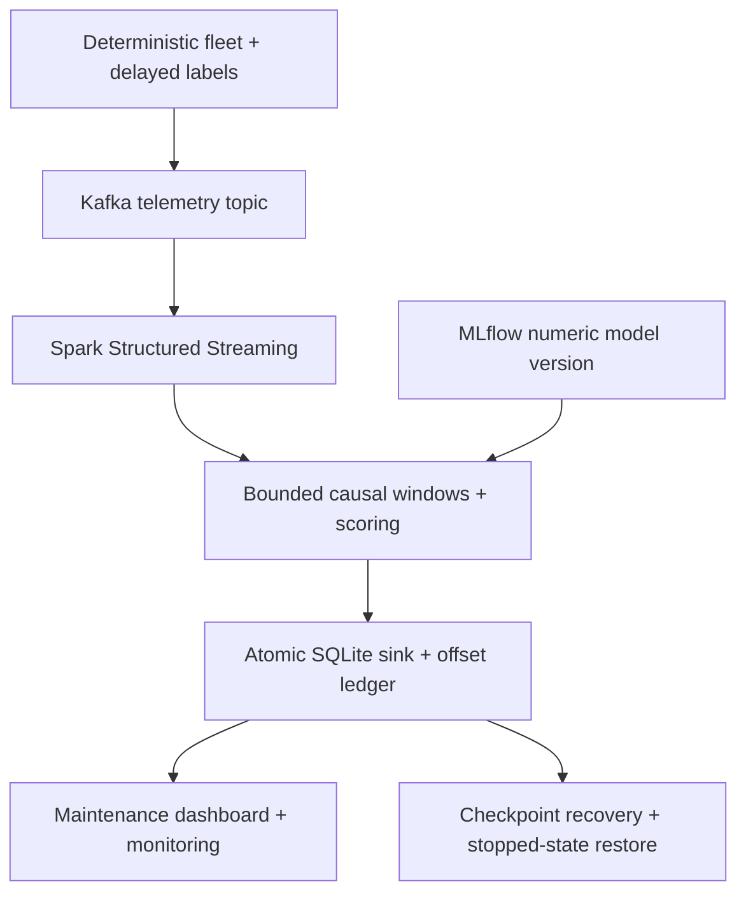

# Industrial Streaming MLOps

**Traceable maintenance warnings from sensor events, with an explicit false-alert budget.**

I built this reference to connect the parts that are often demonstrated separately:
stream ingestion, causal features, model evaluation, deployment identity and recovery.
A maintenance operator can inspect the machine, the sensor window, the model version
and the delayed outcome behind an alert.

The fleet and all its data are synthetic. The local path uses a real Kafka broker,
Spark Structured Streaming and an HTTP MLflow registry. Databricks has a separate
deployment and acceptance path; local Spark does not qualify the provider.

## What the operator gets

- A read-only dashboard showing pipeline freshness, accepted/rejected/duplicate
  messages, pending predictions, machine alerts and prediction-versus-label evidence.
- A fixed alert budget: **at most 2 false alerts per machine-day**, with at least
  **70% useful failure recall** and **5 minutes of actionable lead** on the held-out
  synthetic evaluation. Model-only p95 inference must stay below 1,000 ms.
- Explicit shadow mode when a model has not met its recorded gates.
- Numerical model activation and compatible rollback, separate from registry promotion.
- A raw ledger containing Kafka coordinates, original payload bytes and dispositions,
  so poison records, late arrivals and replays remain explainable.

These thresholds are checked in before evaluation. They are demonstration acceptance
criteria, not a maintenance service-level guarantee for real equipment.

## Qualification status

The [acceptance register](docs/acceptance.md) distinguishes implementation, executed
tests and outstanding qualifications. Original receipts are published with the
reviewed source; a green unit test is not a Kafka or Databricks integration result.

| Area | Current boundary |
|---|---|
| Contracts, causal features, delayed labels, sink recovery | Executable tests in this repository |
| MLflow registry and lifecycle | Real HTTP registration, persistent reload and alias readbacks |
| Kafka/Spark/full local recovery | Reproducible native and container qualification scripts |
| Databricks | Provider implementation prepared; authorized workspace run still required |
| Distributed capacity | Not claimed; the reference sink is intentionally single-host |
| Public release | Owner license decision and public visibility authorization remain open |

See [scope and delivery issue #1](https://github.com/mehdisafer/industrial-streaming-mlops/issues/1).

## Architecture



Spark provides the real Kafka streaming source, envelope parsing, offset progress
and checkpoint lifecycle. The local `foreachBatch` sink runs reviewed validation,
watermark state, features and scoring in one bounded driver process. SQLite provides
one transaction over source dispositions and business outputs. This is a deliberate
small-deployment design, not a distributed feature engine.

The provider path uses Kafka and Delta on existing authorized Databricks compute.
It reuses the feature contract but has separate persistence, run identities and
qualification evidence. Its bounded replay adapter is not a Big Data scale claim.

Read the [architecture decisions](docs/architecture.md), [contracts](docs/data-contracts.md)
and [verified dependency baseline](docs/compatibility.md).

## Run the container reference

Requirements: Docker Engine with Compose v2, and a reference budget of four CPUs,
8 GiB RAM and 10 GiB free disk. These are requested local limits, not measured minimums.
The broker, registry and dashboard are published on loopback only.

```bash
git clone https://github.com/mehdisafer/industrial-streaming-mlops.git
cd industrial-streaming-mlops
docker compose build
docker compose up -d --wait kafka mlflow dashboard

docker compose run --rm cli generate \
  --output /state/input/events.jsonl --machines 6 --hours 24 --anomalies
docker compose run --rm cli train \
  --output /state/training --machines 6 --hours 72
```

Training prints and persists the actual registered numerical versions. On a fresh
registry, baseline and candidate are usually versions 1 and 2; inspect the returned
`model_version` values instead of assuming that on a reused volume.

```bash
# Replace these with the numerical versions returned by the training report.
BASELINE_VERSION=1
CANDIDATE_VERSION=2
docker compose run --rm cli activate --version "$BASELINE_VERSION" --shadow
docker compose run --rm cli promote --version "$CANDIDATE_VERSION"
docker compose run --rm cli activate --version "$CANDIDATE_VERSION"
docker compose run --rm cli produce --input /state/input/events.jsonl
docker compose run --rm cli stream --available-now --duration-seconds 300
docker compose run --rm cli verify
docker compose run --rm cli monitor
```

Promotion refuses a version that fails the stored gates. To inspect an unqualified
model explicitly, use `activate --version N --shadow`; every resulting prediction and
alert retains its shadow label. Drift never promotes a model.

Open [the maintenance dashboard](http://127.0.0.1:8080) and
[MLflow](http://127.0.0.1:5000). Monitoring refreshes after each micro-batch and retained
prediction replay. The dashboard refreshes every five seconds.

```bash
# Restore the previous activated numerical version; registry aliases are separate.
docker compose run --rm cli rollback

# Bounded continuous demonstration, stopping after 300 seconds by default.
docker compose --profile streaming up worker

# Stop services while retaining named volumes and evidence.
docker compose --profile streaming --profile tools down --timeout 45
```

Do not use `down -v` as an everyday stop command: it removes persisted state.
The reference is a bounded demo profile. Unattended operation requires an operator
supervisor, retention policy and the target deployment review described in the runbook.

## Native isolated execution

The native path starts the real JVM broker, MLflow server, Spark and dashboard as
owned child processes. It is useful when Docker is unavailable.

```bash
python -m pip install uv==0.13.6
uv sync --frozen --python 3.11
bash scripts/bootstrap_native.sh
uv run python scripts/fetch_spark_jars.py
uv run python scripts/qualify_native.py \
  --work-dir state/native-run-001 --machines 6 --hours 24 --training-hours 72
```

Use a new work directory for each qualification. The runner preserves original logs,
input manifests, model identities, source hashes and failed attempts. It stops only
its own child processes. Native Linux x86-64 binaries are pinned and checked; the
Docker reference is the portable route for Windows and macOS.

## What the tests exercise

```bash
uv run pytest -q -m "not integration"
uv run ruff check src tests scripts databricks
bash scripts/integration.sh
uv run industrial-mlops benchmark --output state/local-benchmark.json
```

The native qualification tests a real unavailable registry, pending prediction
recovery, batch/stream feature and prediction parity, failures before and after
the sink commit, a broker interruption during an active query, candidate activation,
rollback on new telemetry, the live dashboard and restoration of stopped state.
The container script is a smaller smoke profile with real broker/worker interruptions.
Their receipts state exactly which checks executed.

The standalone benchmark measures the local feature/SQLite sink only. Spark progress
contains source throughput and trigger timing; neither result demonstrates multi-node
capacity. Workloads, partitions, concurrency and measured resource scope belong in
the report, not in an unsupported scalability headline.

## Data and model semantics

Events carry dataset, source, site, machine, identity, UTC event/ingestion times and
schema version. Sensors contain only temperature, vibration, pressure and fixed units.
Labels have separate availability times and never enter model features.

A feature uses `(anchor - 30 minutes, anchor]`, at least four observations, and only
events already available at closure. Per-machine watermarks allow 120 seconds of
lateness. Events at or behind an already finalized watermark are explicitly rejected;
they never silently rewrite a prediction. Heartbeats close the finite demonstration.

The baseline is an explainable vibration/temperature score. The candidate is scaled
logistic regression; preprocessing is fit on training only. Three disjoint synthetic
datasets are ordered in time, and training labels mature before the next split begins.
The operating threshold is selected on validation before final-test scoring.
The [model card](docs/model-card.md) explains alert, recall and lead-time semantics.

The feature signature binds names, units, window, horizon, lateness and minimum
observations. Model artifacts are loaded from a trusted registry with an exact
numerical version, reviewed serializer/type policy and content digest. A digest
proves content correspondence; it does not certify a model.

## Databricks

The bundle uses an explicitly supplied existing cluster. It does not create a
cluster, warehouse, catalog, schema, volume, secret scope or serving endpoint.
Required access, Kafka connectivity, existing storage, trusted model registration
and the bounded provider run are documented in [Databricks qualification](docs/databricks.md).
Provider dependency installation and APIs must be observed on that workspace.

No Databricks execution is claimed from these local tests.

## Operate and extend

- [Incident, backup, restore and migration runbook](docs/operations.md)
- [Acceptance criteria and prioritized backlog](docs/acceptance.md)
- [Release preparation and publication decisions](docs/release-notes.md)
- [Python dependency lock](uv.lock) and [JVM connector lock](config/spark-jars.lock.json)

No client code, identifiers or data are used. The synthetic generator has no third-party
dataset dependency. This repository currently has no owner-approved license; third-party
software retains its own rights. Selecting a repository license, changing visibility
and provisioning paid infrastructure are separate owner decisions.
