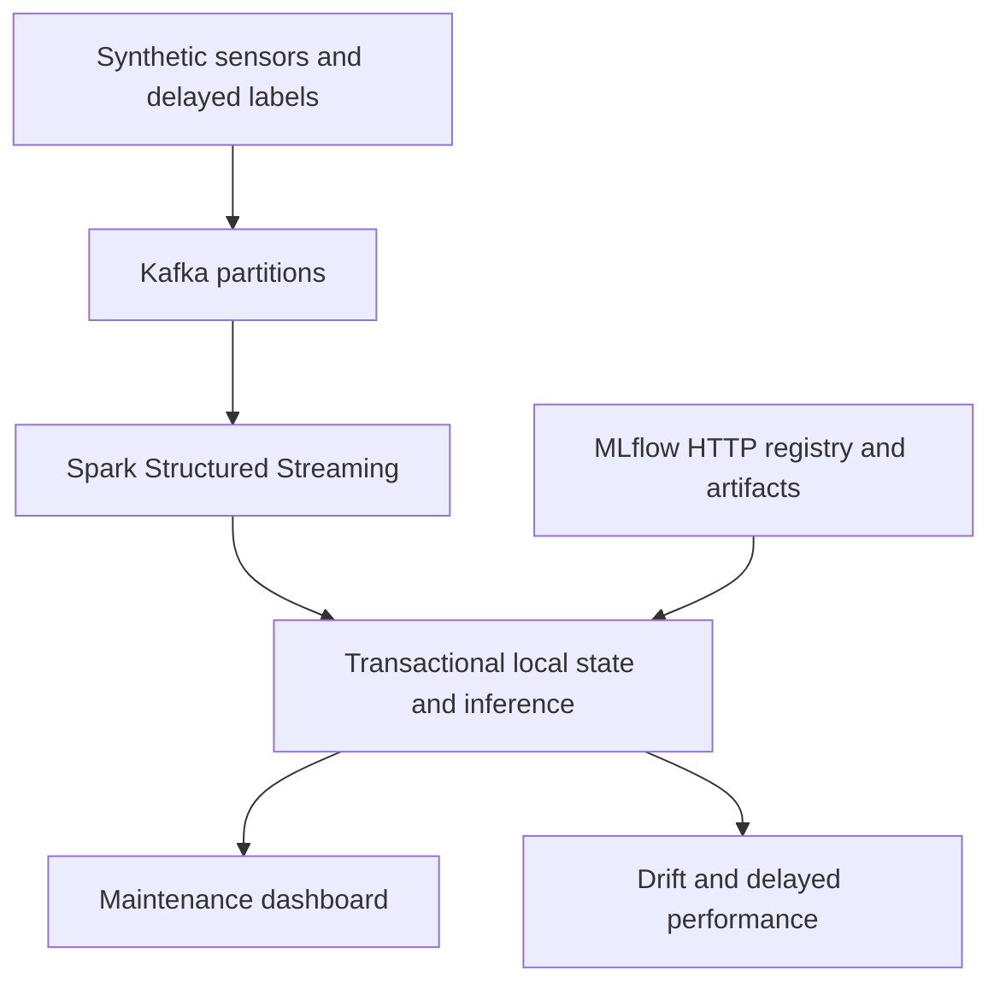

# Architecture and operating boundary

I built this reference around one maintenance question: **which machine needs attention, and what evidence supports that alert?** Synthetic predictions retain observations, feature semantics, dataset and exact model version for inspection after restart.

## What each component does

Kafka preserves partition order with stable dataset/site/machine keys. Changing partition layout requires a new experiment. The producer records acknowledged offsets. Spark projects envelope/business time and checks row/byte bounds before handing a complete micro-batch to the sink.

The **local feature state and inference run on the driver**. SQLite provides a single-writer transaction across raw dispositions, event identities, watermarks, accepted sensors, labels, features, predictions, alerts and the batch ledger. This is a single-host reference, not distributed feature processing or a Big Data benchmark.

MLflow provides HTTP tracking, database metadata and persistent proxied artifacts. The worker loads numerical model versions; aliases cannot silently change prediction provenance. The dashboard reads committed rows through a read-only connection. After micro-batches, monitoring records drift and mature-label performance from **persisted alerts**, preserving cooldown decisions made before the rolling window. It never promotes a model.

## Recovery invariants

`(topic, partition, offset)` identifies one raw record. The ledger preserves base64 source bytes, their hash and a separate null/tombstone flag. Changed bytes or nullness at the same coordinate fail the batch. `event_id` deduplicates logical events; conflicting reuse is rejected. Repeated query/batch identity requires the same input fingerprint.

The sink transaction commits business rows and its replay ledger together. A crash before commit leaves no batch effects; a crash after commit but before Spark checkpoint advancement replays the committed batch without duplicating business rows. This closes that application boundary. Spark's [documented `foreachBatch` semantics](https://spark.apache.org/docs/3.5.9/structured-streaming-programming-guide.html) do not establish exactly-once delivery for the entire system.

The checkpoint binding includes source, query, sink path and complete configuration. Incompatible reuse fails visibly. Raw reconciliation separates accepted sensors, labels, controls, rejects and duplicates; warmup or pending features are not source loss.

## Deployment limits

The [Compose reference](../compose.yaml) uses one KRaft broker, one local Spark worker process, MLflow and the dashboard. Published ports bind to loopback. Kafka, MLflow and dashboard additionally join a
routable ingress bridge for actual localhost access, while worker, CLI and setup
services remain on the internal-only network. **Ingress-connected services may
initiate egress, so the stack is not wholly air-gapped.** Runtime secrets are external. Kafka and MLflow each have a 1 GiB ceiling; the worker has 4 GiB. These limits are configuration, not measured capacity.

There is no high availability. SQLite/raw history retention and cold-state archival are not automated. Kafka retention must exceed the intended recovery interval. [Databricks](databricks.md) uses a separate bounded Delta adapter and requires its own real provider qualification. See [compatibility](compatibility.md) for pinned versions and vendor references.

